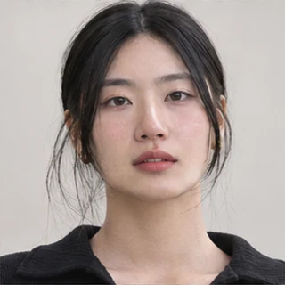

# 全身照資產

以 `assets/avatars/avatar-01.webp`～`avatar-64.webp` 為參考，逐張生成的虛構成年女性全身照。攝影棚白素底，完整頭頂至鞋底構圖。原始頭像保留，遊戲介面與預設頭像不變。

## 配置

- 裙裝／連身裙裝：48 人（75%）；褲裝：16 人（25%）。
- 裙裝中膝上：43 人（89.6%，整數取最接近 90%）；其餘 5 人為及膝以下。
- 有跟鞋：60 人（93.75%）；帆布鞋／運動鞋：4 人（08、24、40、56）。
- 01～32 中短版露腰上衣：8 人（25%），編號 01、03、05、07、09、11、13、15。

各圖為 AI 延伸創作，保留參考人物特徵，但並非真實人物攝影，也不保證臉部像素完全相同。服裝及對應資料見 [manifest.json](manifest.json)。

## 逐張對照

| 編號 | 原始頭像 | 全身照 | 服裝 | 鞋款 |
|---|---|---|---|---|
| avatar-01 |  | [查看全身照](avatar-01.png) | 裙裝・膝上・短版露腰 | 有跟鞋 |
| avatar-02 |  | [查看全身照](avatar-02.png) | 裙裝・膝上 | 有跟鞋 |
| avatar-03 |  | [查看全身照](avatar-03.png) | 裙裝・膝上・短版露腰 | 有跟鞋 |
| avatar-04 |  | [查看全身照](avatar-04.png) | 褲裝 | 有跟鞋 |
| avatar-05 |  | [查看全身照](avatar-05.png) | 裙裝・膝上・短版露腰 | 有跟鞋 |
| avatar-06 |  | [查看全身照](avatar-06.png) | 連身裙裝・膝上 | 有跟鞋 |
| avatar-07 |  | [查看全身照](avatar-07.png) | 裙裝・膝上・短版露腰 | 有跟鞋 |
| avatar-08 |  | [查看全身照](avatar-08.png) | 褲裝 | 帆布鞋 |
| avatar-09 |  | [查看全身照](avatar-09.png) | 裙裝・膝上・短版露腰 | 有跟鞋 |
| avatar-10 |  | [查看全身照](avatar-10.png) | 裙裝・膝上 | 有跟鞋 |
| avatar-11 |  | [查看全身照](avatar-11.png) | 裙裝・膝上・短版露腰 | 有跟鞋 |
| avatar-12 |  | [查看全身照](avatar-12.png) | 褲裝 | 有跟鞋 |
| avatar-13 |  | [查看全身照](avatar-13.png) | 裙裝・膝上・短版露腰 | 有跟鞋 |
| avatar-14 |  | [查看全身照](avatar-14.png) | 裙裝・膝上 | 有跟鞋 |
| avatar-15 |  | [查看全身照](avatar-15.png) | 裙裝・膝上・短版露腰 | 有跟鞋 |
| avatar-16 |  | [查看全身照](avatar-16.png) | 褲裝 | 有跟鞋 |
| avatar-17 |  | [查看全身照](avatar-17.png) | 裙裝・膝上 | 有跟鞋 |
| avatar-18 |  | [查看全身照](avatar-18.png) | 連身裙裝・膝上 | 有跟鞋 |
| avatar-19 |  | [查看全身照](avatar-19.png) | 裙裝・膝上 | 有跟鞋 |
| avatar-20 |  | [查看全身照](avatar-20.png) | 褲裝 | 有跟鞋 |
| avatar-21 |  | [查看全身照](avatar-21.png) | 連身裙裝・膝上 | 有跟鞋 |
| avatar-22 |  | [查看全身照](avatar-22.png) | 裙裝・膝上 | 有跟鞋 |
| avatar-23 |  | [查看全身照](avatar-23.png) | 裙裝・膝上 | 有跟鞋 |
| avatar-24 |  | [查看全身照](avatar-24.png) | 褲裝 | 運動鞋 |
| avatar-25 |  | [查看全身照](avatar-25.png) | 裙裝・膝上 | 有跟鞋 |
| avatar-26 |  | [查看全身照](avatar-26.png) | 裙裝・膝上 | 有跟鞋 |
| avatar-27 |  | [查看全身照](avatar-27.png) | 連身裙裝・膝上 | 有跟鞋 |
| avatar-28 |  | [查看全身照](avatar-28.png) | 褲裝 | 有跟鞋 |
| avatar-29 |  | [查看全身照](avatar-29.png) | 裙裝・膝上 | 有跟鞋 |
| avatar-30 |  | [查看全身照](avatar-30.png) | 連身裙裝・膝上 | 有跟鞋 |
| avatar-31 |  | [查看全身照](avatar-31.png) | 裙裝・膝上 | 有跟鞋 |
| avatar-32 |  | [查看全身照](avatar-32.png) | 褲裝 | 有跟鞋 |
| avatar-33 |  | [查看全身照](avatar-33.png) | 連身裙裝・膝上 | 有跟鞋 |
| avatar-34 |  | [查看全身照](avatar-34.png) | 裙裝・膝上 | 有跟鞋 |
| avatar-35 |  | [查看全身照](avatar-35.png) | 裙裝・及膝以下 | 有跟鞋 |
| avatar-36 |  | [查看全身照](avatar-36.png) | 褲裝 | 有跟鞋 |
| avatar-37 |  | [查看全身照](avatar-37.png) | 裙裝・膝上 | 有跟鞋 |
| avatar-38 |  | [查看全身照](avatar-38.png) | 裙裝・膝上 | 有跟鞋 |
| avatar-39 |  | [查看全身照](avatar-39.png) | 連身裙裝・膝上 | 有跟鞋 |
| avatar-40 |  | [查看全身照](avatar-40.png) | 褲裝 | 帆布鞋 |
| avatar-41 |  | [查看全身照](avatar-41.png) | 裙裝・膝上 | 有跟鞋 |
| avatar-42 |  | [查看全身照](avatar-42.png) | 連身裙裝・膝上 | 有跟鞋 |
| avatar-43 |  | [查看全身照](avatar-43.png) | 裙裝・及膝以下 | 有跟鞋 |
| avatar-44 |  | [查看全身照](avatar-44.png) | 褲裝 | 有跟鞋 |
| avatar-45 |  | [查看全身照](avatar-45.png) | 連身裙裝・膝上 | 有跟鞋 |
| avatar-46 |  | [查看全身照](avatar-46.png) | 裙裝・膝上 | 有跟鞋 |
| avatar-47 |  | [查看全身照](avatar-47.png) | 裙裝・膝上 | 有跟鞋 |
| avatar-48 |  | [查看全身照](avatar-48.png) | 褲裝 | 有跟鞋 |
| avatar-49 |  | [查看全身照](avatar-49.png) | 裙裝・膝上 | 有跟鞋 |
| avatar-50 |  | [查看全身照](avatar-50.png) | 裙裝・膝上 | 有跟鞋 |
| avatar-51 |  | [查看全身照](avatar-51.png) | 裙裝・及膝以下 | 有跟鞋 |
| avatar-52 |  | [查看全身照](avatar-52.png) | 褲裝 | 有跟鞋 |
| avatar-53 |  | [查看全身照](avatar-53.png) | 裙裝・膝上 | 有跟鞋 |
| avatar-54 |  | [查看全身照](avatar-54.png) | 連身裙裝・膝上 | 有跟鞋 |
| avatar-55 |  | [查看全身照](avatar-55.png) | 裙裝・膝上 | 有跟鞋 |
| avatar-56 |  | [查看全身照](avatar-56.png) | 褲裝 | 帆布鞋 |
| avatar-57 |  | [查看全身照](avatar-57.png) | 連身裙裝・膝上 | 有跟鞋 |
| avatar-58 |  | [查看全身照](avatar-58.png) | 裙裝・膝上 | 有跟鞋 |
| avatar-59 |  | [查看全身照](avatar-59.png) | 裙裝・及膝以下 | 有跟鞋 |
| avatar-60 |  | [查看全身照](avatar-60.png) | 褲裝 | 有跟鞋 |
| avatar-61 |  | [查看全身照](avatar-61.png) | 裙裝・膝上 | 有跟鞋 |
| avatar-62 |  | [查看全身照](avatar-62.png) | 裙裝・膝上 | 有跟鞋 |
| avatar-63 |  | [查看全身照](avatar-63.png) | 裙裝・及膝以下 | 有跟鞋 |
| avatar-64 |  | [查看全身照](avatar-64.png) | 褲裝 | 有跟鞋 |

## 人物更新

35、38 已重新設計頭像與全身照，以區別於 33 及彼此。35 為紅黑短碎髮搖滾風、皮衣、中長格裙及有跟短靴；38 為圓臉、直瀏海高馬尾、眼鏡、奶油白襯衫、淺藍膝上裙與有跟鞋。原有服裝比例維持不變。
