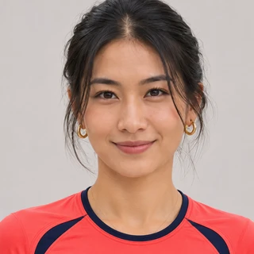
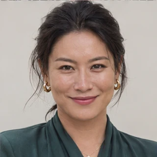

# 全身照資產

以 `assets/avatars/avatar-01.webp`～`avatar-64.webp` 為參考，逐張生成的虛構成年女性全身照。攝影棚白素底，完整頭頂至鞋底構圖。原始頭像保留，遊戲介面與預設頭像不變。

## 配置

- 裙裝／連身裙裝：46 人（71.9%）；褲裝：18 人（28.1%），依後續指定更新。
- 裙裝中膝上：40 人（87.0%）；其餘 6 人為及膝以下。
- 有跟鞋：51 人（79.7%）；帆布鞋／運動鞋：6 人（06、08、13、24、27、38）；其他平底鞋：7 人（04、05、09、22、23、39、42）。
- 01～32 中短版露腰上衣：10 人（31.25%），編號 01、03、04、05、07、09、11、15、22、30。

各圖為 AI 延伸創作，保留參考人物特徵，但並非真實人物攝影，也不保證臉部像素完全相同。服裝及對應資料見 [manifest.json](manifest.json)。

## 逐張對照

| 編號 | 原始頭像 | 全身照 | 服裝 | 鞋款 |
|---|---|---|---|---|
| avatar-01 |  | [查看全身照](avatar-01.webp) | 裙裝・膝上・短版露腰 | 有跟鞋 |
| avatar-02 |  | [查看全身照](avatar-02.webp) | 一字領上衣・膝上裙 | 黑色高筒跟靴 |
| avatar-03 |  | [查看全身照](avatar-03.webp) | 裙裝・膝上・短版露腰 | 有跟鞋 |
| avatar-04 |  | [查看全身照](avatar-04.webp) | 牛仔熱褲・短版露腰內搭 | 平底鞋 |
| avatar-05 |  | [查看全身照](avatar-05.webp) | 裙裝・膝上・短版露腰 | 平底鞋 |
| avatar-06 |  | [查看全身照](avatar-06.webp) | 褲裝 | 帆布鞋 |
| avatar-07 |  | [查看全身照](avatar-07.webp) | 裙裝・膝上・短版露腰 | 有跟鞋 |
| avatar-08 |  | [查看全身照](avatar-08.webp) | 褲裝 | 帆布鞋 |
| avatar-09 |  | [查看全身照](avatar-09.webp) | 長裙・及膝以下・短版露腰 | 平底鞋 |
| avatar-10 |  | [查看全身照](avatar-10.webp) | 牛仔短裙 | 有跟鞋 |
| avatar-11 |  | [查看全身照](avatar-11.webp) | 裙裝・膝上・短版露腰 | 有跟鞋 |
| avatar-12 |  | [查看全身照](avatar-12.webp) | 褲裝 | 有跟鞋 |
| avatar-13 |  | [查看全身照](avatar-13.webp) | 裙裝・膝上 | 帆布鞋 |
| avatar-14 |  | [查看全身照](avatar-14.webp) | 牛仔短裙 | 有跟鞋 |
| avatar-15 |  | [查看全身照](avatar-15.webp) | 裙裝・膝上・短版露腰 | 有跟鞋 |
| avatar-16 |  | [查看全身照](avatar-16.webp) | 褲裝 | 有跟鞋 |
| avatar-17 |  | [查看全身照](avatar-17.webp) | 裙裝・膝上 | 有跟鞋 |
| avatar-18 |  | [查看全身照](avatar-18.webp) | 裙裝・膝上 | 有跟鞋 |
| avatar-19 |  | [查看全身照](avatar-19.webp) | 裙裝・及膝以下 | 有跟鞋 |
| avatar-20 |  | [查看全身照](avatar-20.webp) | 褲裝 | 有跟鞋 |
| avatar-21 |  | [查看全身照](avatar-21.webp) | 裙裝・膝上 | 有跟鞋 |
| avatar-22 |  | [查看全身照](avatar-22.webp) | 一般短裙・膝上・短版露腰 | 平底鞋 |
| avatar-23 |  | [查看全身照](avatar-23.webp) | 裙裝・膝上 | 平底鞋 |
| avatar-24 |  | [查看全身照](avatar-24.webp) | 褲裝 | 運動鞋 |
| avatar-25 |  | [查看全身照](avatar-25.webp) | 裙裝・膝上 | 有跟鞋 |
| avatar-26 |  | [查看全身照](avatar-26.webp) | 裙裝・膝上 | 有跟鞋 |
| avatar-27 |  | [查看全身照](avatar-27.webp) | 褲裝・運動短褲 | 運動鞋 |
| avatar-28 |  | [查看全身照](avatar-28.webp) | 褲裝 | 有跟鞋 |
| avatar-29 |  | [查看全身照](avatar-29.webp) | 褲裝・牛仔短褲 | 有跟鞋 |
| avatar-30 |  | [查看全身照](avatar-30.webp) | 裙裝・膝上・短版露腰 | 有跟鞋 |
| avatar-31 |  | [查看全身照](avatar-31.webp) | 裙裝・膝上 | 有跟鞋 |
| avatar-32 |  | [查看全身照](avatar-32.webp) | 褲裝 | 有跟鞋 |
| avatar-33 |  | [查看全身照](avatar-33.webp) | 連身裙裝・膝上 | 有跟鞋 |
| avatar-34 |  | [查看全身照](avatar-34.webp) | 裙裝・膝上 | 有跟鞋 |
| avatar-35 |  | [查看全身照](avatar-35.webp) | 裙裝・及膝以下 | 有跟鞋 |
| avatar-36 |  | [查看全身照](avatar-36.webp) | 褲裝 | 有跟鞋 |
| avatar-37 |  | [查看全身照](avatar-37.webp) | 裙裝・膝上 | 有跟鞋 |
| avatar-38 |  | [查看全身照](avatar-38.webp) | 裙裝・膝上 | 運動鞋 |
| avatar-39 |  | [查看全身照](avatar-39.webp) | 連身裙裝・膝上 | 平底鞋 |
| avatar-40 |  | [查看全身照](avatar-40.webp) | 裙裝・膝上 | 有跟鞋 |
| avatar-41 |  | [查看全身照](avatar-41.webp) | 裙裝・膝上 | 有跟鞋 |
| avatar-42 |  | [查看全身照](avatar-42.webp) | 連身裙裝・膝上 | 平底鞋 |
| avatar-43 |  | [查看全身照](avatar-43.webp) | 裙裝・及膝以下 | 有跟鞋 |
| avatar-44 |  | [查看全身照](avatar-44.webp) | 褲裝 | 有跟鞋 |
| avatar-45 |  | [查看全身照](avatar-45.webp) | 連身裙裝・膝上 | 有跟鞋 |
| avatar-46 |  | [查看全身照](avatar-46.webp) | 裙裝・膝上 | 有跟鞋 |
| avatar-47 |  | [查看全身照](avatar-47.webp) | 裙裝・膝上 | 有跟鞋 |
| avatar-48 |  | [查看全身照](avatar-48.webp) | 褲裝 | 有跟鞋 |
| avatar-49 |  | [查看全身照](avatar-49.webp) | 裙裝・膝上 | 有跟鞋 |
| avatar-50 |  | [查看全身照](avatar-50.webp) | 裙裝・膝上 | 有跟鞋 |
| avatar-51 |  | [查看全身照](avatar-51.webp) | 裙裝・及膝以下 | 有跟鞋 |
| avatar-52 |  | [查看全身照](avatar-52.webp) | 褲裝 | 有跟鞋 |
| avatar-53 |  | [查看全身照](avatar-53.webp) | 裙裝・膝上 | 有跟鞋 |
| avatar-54 |  | [查看全身照](avatar-54.webp) | 連身裙裝・膝上 | 有跟鞋 |
| avatar-55 |  | [查看全身照](avatar-55.webp) | 裙裝・膝上 | 有跟鞋 |
| avatar-56 |  | [查看全身照](avatar-56.webp) | 連身裙裝・膝上 | 有跟鞋 |
| avatar-57 |  | [查看全身照](avatar-57.webp) | 連身裙裝・膝上 | 有跟鞋 |
| avatar-58 |  | [查看全身照](avatar-58.webp) | 裙裝・膝上 | 有跟鞋 |
| avatar-59 |  | [查看全身照](avatar-59.webp) | 牛仔長褲 | 有跟鞋 |
| avatar-60 |  | [查看全身照](avatar-60.webp) | 褲裝 | 有跟鞋 |
| avatar-61 |  | [查看全身照](avatar-61.webp) | 裙裝・膝上 | 有跟鞋 |
| avatar-62 |  | [查看全身照](avatar-62.webp) | 裙裝・膝上 | 有跟鞋 |
| avatar-63 |  | [查看全身照](avatar-63.webp) | 裙裝・及膝以下 | 有跟鞋 |
| avatar-64 |  | [查看全身照](avatar-64.webp) | 褲裝 | 有跟鞋 |

## 新增國際角色

四位皆為 AI 生成的虛構成年女性，圖片生成時設定為 25 歲；遊戲新生成時年齡為 22～30 歲等機率隨機分配（含兩端）。先生成頭像，再參考頭像生成全身照，保留人物特徵與服裝。頭像為 320 × 320 WebP，四位全身照均為 512 × 1024 WebP。

| 人物 | 國籍／族裔設定 | 綁定姓氏 |
|---|---|---|
| avatar-jp | 日本人 | 佐藤 |
| avatar-kr | 韓國人 | 金 |
| avatar-vn | 越南人 | 阮 |
| avatar-us | 美國白人 | 史密斯 |

共 68 位角色，採加權不重複抽選：每位台灣人物權重為 1，4 位外國人物各為 1/4，初始總權重為 65。第一抽的外國人物合計機率為 1/65，指定外國人物為 1/260；每抽移除已選人物，後續依剩餘權重重新計算。同批可抽到多位不同外國人物，最多 4 位。新建參賽者與新回合的新人物會依頭像帶入上述姓氏，年齡則從 22～30 歲等機率隨機分配，姓名沿用「姓氏＋小姐」格式。既有／匯入人物保留已存姓名及年齡，仍可手動編輯。

## 派發人物的起始衣物

前台 68 位角色的新建人物起始衣物依 [確認版盤點表](clothing-audit.csv) 設定，適用新建遊戲與新回合的新人物。所有人包含胸罩、內褲；長短褲歸褲子，褲裙歸褲子，連身服裝歸洋裝，黑絲襪歸褲襪。

13／25 的背心歸外套；42 僅列洋裝；45 依指定列外套＋上衣；47 列外套＋上衣＋裙子，64 列外套＋上衣＋褲子。已儲存、匯入及手動設定的衣物沿用原資料；仍可使用原有衣物設定控制。

## 07／31／45／47／59 髮色更新

五位角色的全身照與 `../profile/` 頭像同步改為淡栗棕、略帶自然金色光澤，沿用原有髮型及服裝；衣物分類不變。

## 02 外型與服裝更新

`avatar-02` 改為虛構成年台灣與白人混血女性設定，五官較立體、膚色偏白，採全新較青澀的成年人物臉孔（22 歲生成設定、柔和圓潤臉型、自然平眉、較圓眼型、小巧鼻唇、接近素顏的淡妝）、東亞面容與深栗棕側分長捲髮，身形修長；服裝為米白一字領上衣、綠色膝上裙與黑色高筒跟靴。頭像同步由新版全身照裁切；起始衣物為上衣、裙子、胸罩、內褲。

## 03 嘴型更新

`avatar-03` 以日本演員夏帆的嘴型感覺為參考，改為小巧、略帶鳥嘴感的自然人類嘴型，上唇中央較前突、唇峰微翹。頭像由新版全身照裁切；服裝、髮型、身形與鞋款沿用原設定。
