# 全身照資產

以 `assets/avatars/avatar-01.webp`～`avatar-64.webp` 為參考，逐張生成的虛構成年女性全身照。攝影棚白素底，完整頭頂至鞋底構圖。原始頭像保留，遊戲介面與預設頭像不變。

## 配置（01～64）

- 裙裝／連身裙裝：46 人（71.9%）；褲裝：18 人（28.1%）。
  - 膝上裙裝：40 人（占裙裝 87.0%，編號 01、02、03、05、07、10、11、13、14、15、17、18、21、22、23、25、26、30、31、33、34、37、38、39、40、41、42、45、46、47、49、50、53、54、55、56、57、58、61、62）。
  - 及膝以下裙裝：6 人（09、19、35、43、51、63）。
  - 長褲：13 人（06、12、16、20、28、32、36、44、48、52、59、60、64）。
  - 短褲：5 人（04、08、24、27、29）。
- 有跟鞋：50 人（78.1%）；帆布鞋／運動鞋：6 人（06、08、13、24、27、38）；其他平底鞋：8 人（04、05、09、20、22、23、39、42）。
- 01～32 中短版露腰上衣：10 人（31.25%），編號 01、03、04、05、07、09、11、15、22、30。
- 髮長：及肩或更長 48 人（含綁髮或盤髮）；未及肩 16 人（04、14、16、18、20、28、29、32、36、45、48、49、50、52、57、64）。
- 染髮：32 人（01、02、04、05、07、10、11、12、14、15、20、21、22、23、24、28、31、33、35、36、38、41、45、47、52、53、54、55、56、58、59、60）；未染髮 32 人。

各圖為 AI 延伸創作，保留參考人物特徵，但並非真實人物攝影，也不保證臉部像素完全相同。

## 逐張對照

| 編號 | 頭像 | 全身照 | 服裝與鞋款 |
|---|---|---|---|
| avatar-01 |  | [查看全身照](avatar-01.webp) | 短版襯衫、短裙、有跟鞋 |
| avatar-02 | 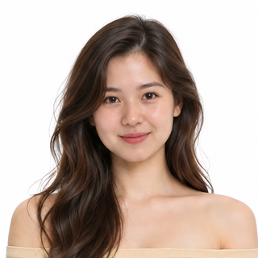 | [查看全身照](avatar-02.webp) | 一字領上衣、短裙、高筒跟靴 |
| avatar-03 | 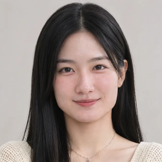 | [查看全身照](avatar-03.webp) | 短版泡泡袖上衣、短裙、有跟鞋 |
| avatar-04 | 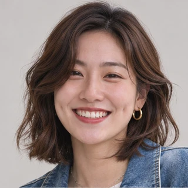 | [查看全身照](avatar-04.webp) | 牛仔外套、短版上衣、牛仔短褲、平底鞋 |
| avatar-05 | 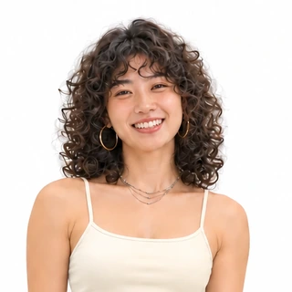 | [查看全身照](avatar-05.webp) | 藕粉色素面細肩帶短版上衣、米白短裙、米白芭蕾平底鞋 |
| avatar-06 | 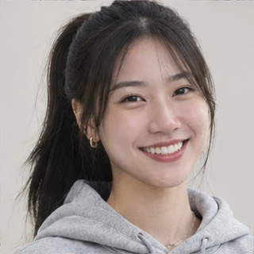 | [查看全身照](avatar-06.webp) | 連帽上衣、牛仔長褲、帆布鞋 |
| avatar-07 | 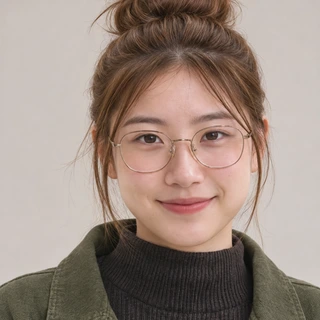 | [查看全身照](avatar-07.webp) | 短版外套、短版上衣、短裙、有跟鞋 |
| avatar-08 |  | [查看全身照](avatar-08.webp) | 泡泡袖上衣、短褲、帆布鞋 |
| avatar-09 | 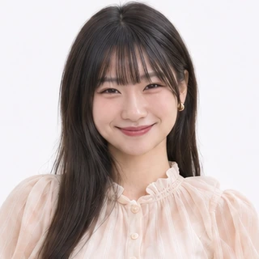 | [查看全身照](avatar-09.webp) | 短版上衣、長裙、平底鞋 |
| avatar-10 | 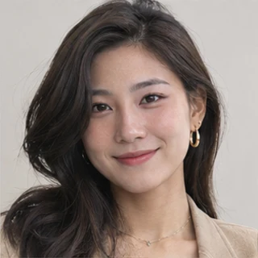 | [查看全身照](avatar-10.webp) | 西裝外套、背心、牛仔短裙、有跟鞋 |
| avatar-11 |  | [查看全身照](avatar-11.webp) | 短版泡泡袖上衣、短裙、有跟鞋 |
| avatar-12 |  | [查看全身照](avatar-12.webp) | 針織上衣、長褲、有跟鞋 |
| avatar-13 |  | [查看全身照](avatar-13.webp) | 襯衫、針織背心、短裙、帆布鞋 |
| avatar-14 |  | [查看全身照](avatar-14.webp) | 襯衫、牛仔短裙、有跟鞋 |
| avatar-15 |  | [查看全身照](avatar-15.webp) | 短版針織上衣、短裙、有跟鞋 |
| avatar-16 |  | [查看全身照](avatar-16.webp) | 針織外套、牛仔長褲、有跟鞋 |
| avatar-17 |  | [查看全身照](avatar-17.webp) | 長袖上衣、短裙、有跟鞋 |
| avatar-18 | 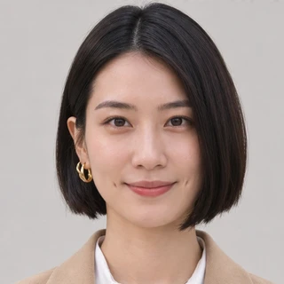 | [查看全身照](avatar-18.webp) | 西裝外套、襯衫、短裙、褲襪、有跟鞋 |
| avatar-19 |  | [查看全身照](avatar-19.webp) | 針織上衣、長裙、有跟鞋 |
| avatar-20 |  | [查看全身照](avatar-20.webp) | 襯衫、長褲、平底鞋 |
| avatar-21 |  | [查看全身照](avatar-21.webp) | 襯衫、短裙、有跟鞋 |
| avatar-22 | 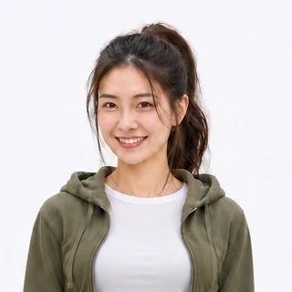 | [查看全身照](avatar-22.webp) | 霧藍韓系長版大衣、象牙白短版上衣、酒紅短裙、米白芭蕾平底鞋 |
| avatar-23 |  | [查看全身照](avatar-23.webp) | 西裝外套、高領上衣、短裙、平底鞋 |
| avatar-24 |  | [查看全身照](avatar-24.webp) | 長袖上衣、短褲、運動鞋 |
| avatar-25 |  | [查看全身照](avatar-25.webp) | 襯衫、針織背心、短裙、有跟鞋 |
| avatar-26 |  | [查看全身照](https://raw.githubusercontent.com/lhx2026-seven/rps-sp/791678841fe0842199df55b4d10fe0b650b5017d/assets/fullbody/avatar-26.webp) | 襯衫、短裙、粗跟鞋 |
| avatar-27 |  | [查看全身照](avatar-27.webp) | 運動背心、運動短褲、運動鞋 |
| avatar-28 | 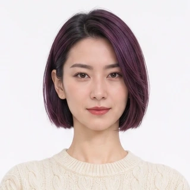 | [查看全身照](avatar-28.webp) | 合身襯衫、貼身皮長褲、細跟尖頭鞋 |
| avatar-29 |  | [查看全身照](avatar-29.webp) | 牛仔外套、T恤、牛仔短褲、有跟鞋 |
| avatar-30 |  | [查看全身照](avatar-30.webp) | 短版襯衫、短裙、有跟鞋 |
| avatar-31 |  | [查看全身照](avatar-31.webp) | 蝴蝶結襯衫、短裙、褲襪、高跟鞋 |
| avatar-32 |  | [查看全身照](avatar-32.webp) | 西裝外套、T恤、牛仔長褲、有跟鞋 |
| avatar-33 |  | [查看全身照](avatar-33.webp) | 連身裙、有跟鞋 |
| avatar-34 |  | [查看全身照](avatar-34.webp) | 西裝外套、襯衫、短裙、有跟鞋 |
| avatar-35 |  | [查看全身照](avatar-35.webp) | 皮外套、上衣、長裙、有跟鞋 |
| avatar-36 |  | [查看全身照](https://raw.githubusercontent.com/lhx2026-seven/rps-sp/04d7771f4be29b83d74e8b35f15b7b3eca9fcf3d/assets/fullbody/avatar-36.webp) | 翻領針織上衣、長褲、高跟鞋 |
| avatar-37 |  | [查看全身照](avatar-37.webp) | 襯衫、短裙、有跟鞋 |
| avatar-38 |  | [查看全身照](avatar-38.webp) | 襯衫、短裙、運動鞋 |
| avatar-39 |  | [查看全身照](avatar-39.webp) | 連身裙、平底鞋 |
| avatar-40 |  | [查看全身照](avatar-40.webp) | 蝴蝶結襯衫、短裙、有跟鞋 |
| avatar-41 |  | [查看全身照](avatar-41.webp) | 襯衫、短裙、有跟鞋 |
| avatar-42 |  | [查看全身照](avatar-42.webp) | 針織上衣、無肩帶連身裙、平底鞋 |
| avatar-43 |  | [查看全身照](avatar-43.webp) | 西裝外套、上衣、長裙、有跟鞋 |
| avatar-44 |  | [查看全身照](avatar-44.webp) | 西裝褲套裝、襯衫、針織背心、有跟鞋 |
| avatar-45 |  | [查看全身照](avatar-45.webp) | 西裝式連身裙、有跟鞋 |
| avatar-46 | 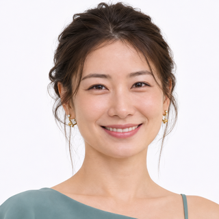 | [查看全身照](avatar-46.webp) | 梅紫色單邊細肩帶上衣、灰色短裙、灰色粗跟鞋；腿部比例略微拉長 |
| avatar-47 |  | [查看全身照](avatar-47.webp) | 短版外套、上衣、短裙、有跟鞋 |
| avatar-48 |  | [查看全身照](avatar-48.webp) | 西裝外套、上衣、牛仔長褲、有跟鞋 |
| avatar-49 |  | [查看全身照](avatar-49.webp) | 西裝外套、上衣、短裙、有跟鞋 |
| avatar-50 |  | [查看全身照](avatar-50.webp) | 無袖上衣、短裙、有跟鞋 |
| avatar-51 |  | [查看全身照](avatar-51.webp) | 無袖上衣、長裙、有跟鞋 |
| avatar-52 |  | [查看全身照](avatar-52.webp) | 西裝褲套裝、針織上衣、高跟鞋 |
| avatar-53 |  | [查看全身照](avatar-53.webp) | 針織上衣、短裙、有跟鞋 |
| avatar-54 |  | [查看全身照](avatar-54.webp) | 西裝式連身裙、有跟鞋 |
| avatar-55 | 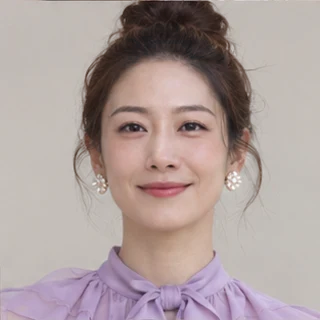 | [查看全身照](avatar-55.webp) | 蝴蝶結襯衫、短裙、有跟鞋 |
| avatar-56 |  | [查看全身照](avatar-56.webp) | 長袖連身裙、有跟鞋 |
| avatar-57 |  | [查看全身照](avatar-57.webp) | 七分袖連身裙、有跟鞋 |
| avatar-58 |  | [查看全身照](avatar-58.webp) | 單肩上衣、短裙、有跟鞋 |
| avatar-59 | 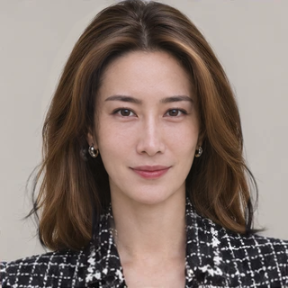 | [查看全身照](avatar-59.webp) | 粗花呢外套、羅紋上衣、直筒牛仔長褲、尖頭跟鞋 |
| avatar-60 |  | [查看全身照](https://raw.githubusercontent.com/lhx2026-seven/rps-sp/2089a9a72726fe528cbe7c9e9beac789a4c3d8ee/assets/fullbody/avatar-60.webp) | 蝴蝶結襯衫、長褲、有跟鞋 |
| avatar-61 |  | [查看全身照](avatar-61.webp) | 西裝外套、上衣、短裙、有跟鞋 |
| avatar-62 |  | [查看全身照](avatar-62.webp) | 垂領上衣、短裙、有跟鞋 |
| avatar-63 |  | [查看全身照](avatar-63.webp) | 襯衫、長裙、有跟鞋 |
| avatar-64 |  | [查看全身照](avatar-64.webp) | 粗花呢外套、上衣、牛仔長褲、有跟鞋 |

## 新增國際角色

四位皆為 AI 生成的虛構成年女性，圖片生成時設定為 25 歲；遊戲新生成時年齡為 22～30 歲等機率隨機分配（含兩端）。先生成頭像，再參考頭像生成全身照，保留人物特徵與服裝。頭像為 320 × 320 WebP，四位全身照均為 512 × 1024 WebP。

| 人物 | 國籍／族裔設定 | 綁定姓氏 |
|---|---|---|
| avatar-jp | 日本人 | 佐藤 |
| avatar-kr | 韓國人 | 金 |
| avatar-vn | 越南人 | 阮 |
| avatar-us | 美國白人 | 史密斯 |

共 68 位角色，採加權不重複抽選：每位台灣人物權重為 1，4 位外國人物各為 1/4，初始總權重為 65。第一抽的外國人物合計機率為 1/65，指定外國人物為 1/260；每抽移除已選人物，後續依剩餘權重重新計算。同批可抽到多位不同外國人物，最多 4 位。新建參賽者與新回合的新人物會依頭像帶入上述姓氏，年齡則從 22～30 歲等機率隨機分配，姓名沿用「姓氏＋小姐」格式。既有／匯入人物保留已存姓名及年齡，仍可手動編輯。

## 派發人物的起始衣物

前台 68 位角色的新建人物起始衣物依遊戲程式的設定套用，適用新建遊戲與新回合的新人物。所有人包含胸罩、內褲；長短褲歸褲子，褲裙歸褲子，連身服裝歸洋裝，黑絲襪歸褲襪。

13／25 的背心歸外套；42 僅列洋裝；45 依指定列外套＋上衣；47 列外套＋上衣＋裙子，64 列外套＋上衣＋褲子。已儲存、匯入及手動設定的衣物沿用原資料；仍可使用原有衣物設定控制。

## 服裝更新（2026-11-27）

05、22、46 的頭像與全身照已同步更新，保留原人物特徵；新版頭像由對應全身照裁切製作，以維持人物與服裝一致。05 改素色細肩帶上衣；22 改韓系長版大衣並換成霧藍／象牙白／酒紅配色；46 改單邊細肩帶上衣，腿部比例略微拉長。三位的遊戲起始衣物分類不變。
